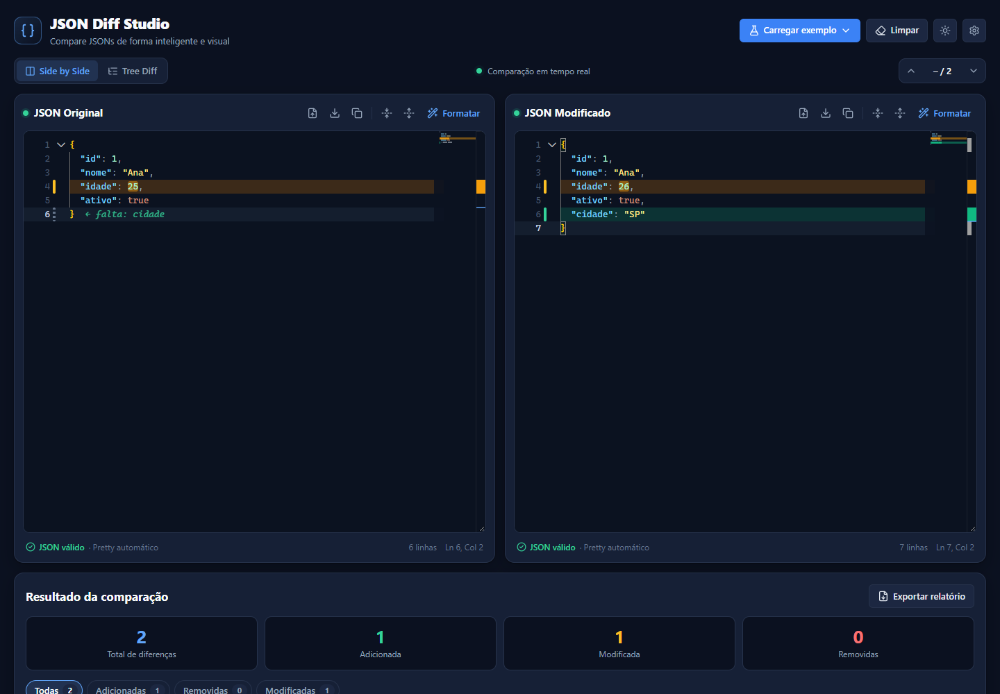
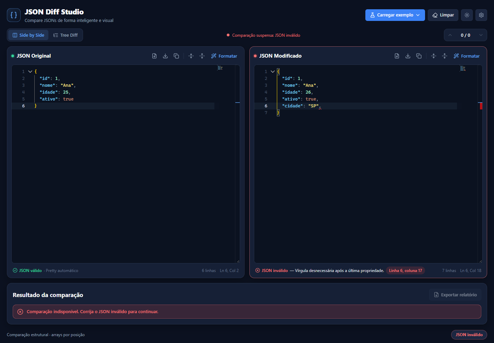
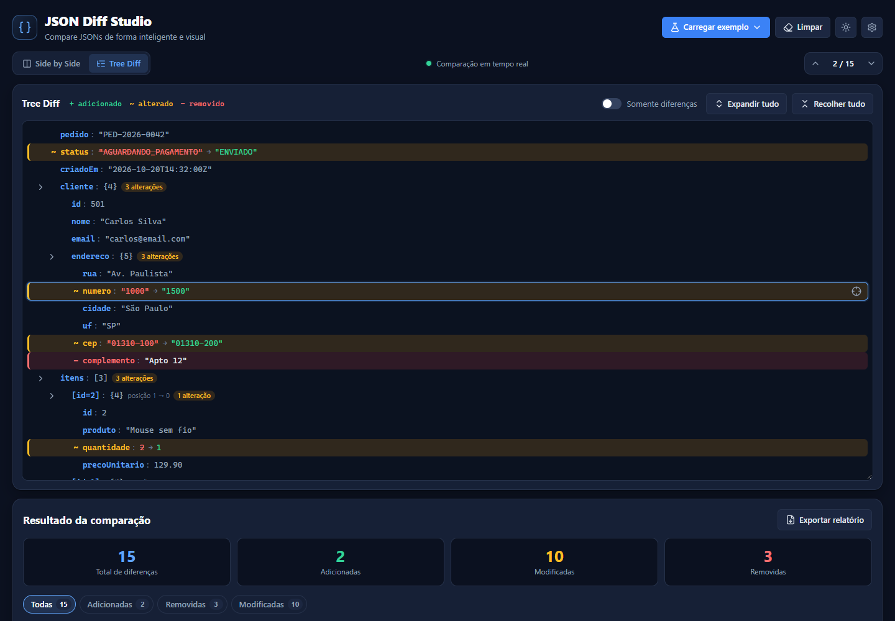
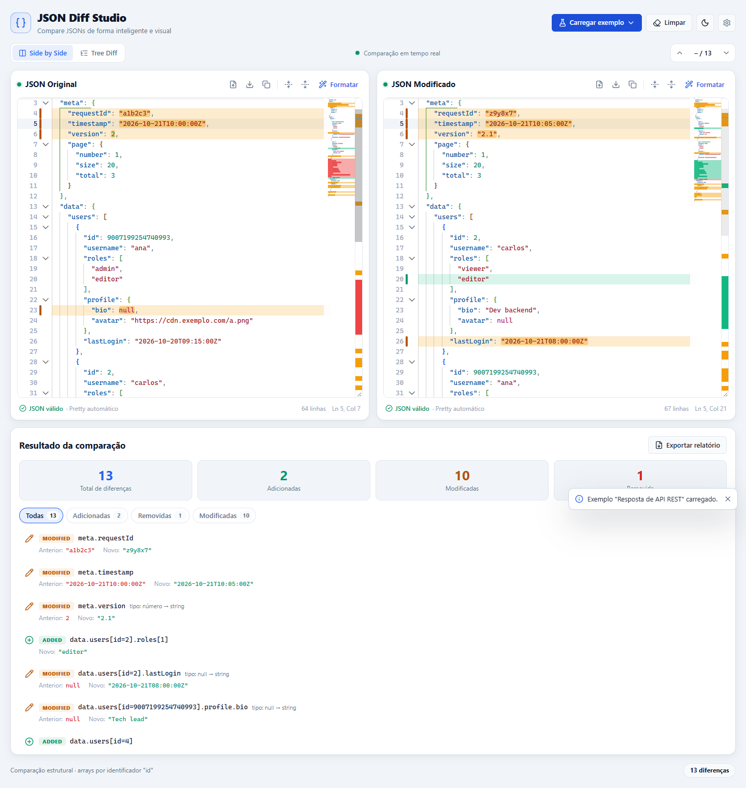

<div align="center">

# `{ }` JSON Diff Studio

**Compare JSONs de forma inteligente e visual — 100% no navegador.**

Validação sintática em tempo real · Pretty Print automático · Diff estrutural destacado no Monaco Editor · Tree Diff




</div>

---

## Sumário

- [Visão geral](#visão-geral)
- [Funcionalidades](#funcionalidades)
- [Capturas de tela](#capturas-de-tela)
- [Começando](#começando)
- [Como usar](#como-usar)
- [Arquitetura](#arquitetura)
- [Decisões técnicas](#decisões-técnicas)
- [Testes](#testes)
- [Publicação como site estático](#publicação-como-site-estático)
- [Limitações conhecidas](#limitações-conhecidas)

---

## Visão geral

O **JSON Diff Studio** é uma ferramenta para desenvolvedores que compara dois documentos JSON pela **estrutura e pelos valores**, não pelo texto. Reordenar propriedades ou mudar a indentação não gera diferenças; mudar um valor, um tipo ou a presença de uma propriedade gera.

Tudo roda no navegador: não há backend, banco de dados nem chamadas a APIs externas. Os documentos nunca saem da máquina do usuário.

## Funcionalidades

| Recurso | Detalhes |
| --- | --- |
| **Pretty Print automático** | Ao colar ou importar um JSON válido, o documento é formatado na hora (2 ou 4 espaços), com o cursor reposicionado no ponto equivalente. `Ctrl+Z` desfaz a formatação. Números e strings são preservados token a token. |
| **Validação sintática** | Parser próprio com mensagens em português, linha e coluna exatas, sublinhado vermelho, marcador na régua e tooltip no Monaco. Estados: *vazio*, *processando*, *válido* e *inválido*. |
| **Comparação estrutural em tempo real** | Algoritmo recursivo próprio: `ADDED`, `REMOVED`, `MODIFIED` (valor ou tipo). Diferencia propriedade ausente de propriedade `null`. Recalcula com debounce enquanto você digita. |
| **Destaque no editor** | Linhas e valores coloridos (verde/vermelho/amarelo), indicador de ausência no lado onde a propriedade não existe, régua de visão geral e minimapa. Diagnósticos de sintaxe e decorações de diff são canais separados. |
| **Navegação entre diferenças** | Anterior/próxima (`Shift+F7` / `F7`), indicador `2 / 5`, rolagem automática e destaque temporário. |
| **Tree Diff** | Árvore hierárquica com expandir/recolher, *somente diferenças*, contagem de alterações aninhadas e botão para localizar o nó no editor. Filhos só são renderizados quando o nó é expandido. |
| **Arrays inteligentes** | Comparação **por posição** ou **por identificador** (`id`, `codigo`, `uuid`...). Trocar a ordem dos itens não gera diferenças; identificadores ausentes ou duplicados geram avisos claros e a comparação recai para posição. |
| **Propriedades ignoradas** | Por nome (`updatedAt`) ou caminho completo (`meta.requestId`), com sugestões para campos voláteis. |
| **Importação e exportação** | Importar `.json` (botão ou arrastar e soltar), exportar cada documento, copiar JSON formatado e exportar um **relatório de diferenças** em JSON. |
| **Exemplos** | Cadastro de usuário, pedido de e-commerce, resposta de API REST e um exemplo de **JSON inválido** para demonstrar validação e recuperação. |
| **Tema claro/escuro** | Escuro por padrão; preferências persistidas localmente. Layout responsivo até 360 px. |

## Capturas de tela

| Validação e suspensão da comparação | Tree Diff (arrays por identificador) |
| --- | --- |
|  |  |

<details>
<summary>Tema claro</summary>



</details>

## Começando

### Pré-requisitos

- **Node.js** 22 LTS ou superior (desenvolvido com Node 24)
- **npm** 10 ou superior

### Instalação e execução

```bash
npm install
npm start          # http://localhost:4200
```

### Scripts

| Comando | Descrição |
| --- | --- |
| `npm start` | Servidor de desenvolvimento com recarga automática. |
| `npm run build` | Build de produção em `dist/jsondiffstudio/browser/`. |
| `npm test` | Testes unitários e de componentes (Vitest + jsdom) em modo watch. |
| `npm test -- --watch=false` | Execução única dos testes (ideal para CI). |
| `npx prettier --write "src/**/*.{ts,html,scss}"` | Formatação do código. |

## Como usar

1. Cole um JSON em cada editor — ou use **Carregar exemplo**.
2. O documento é formatado e validado automaticamente; o resumo e a lista de diferenças são atualizados em tempo real.
3. Clique em uma diferença (ou use `F7`) para ir até ela no editor.
4. Alterne para **Tree Diff** para ver a hierarquia completa.
5. Em **Configurações** (ícone de engrenagem), escolha indentação, modo de comparação de arrays e propriedades a ignorar.

### Atalhos de teclado

| Atalho | Ação |
| --- | --- |
| `F7` / `Shift+F7` | Próxima / anterior diferença |
| `Shift+Alt+F` | Formatar o documento do editor em foco |
| `Ctrl+F` | Buscar no editor |
| `Ctrl+Z` | Desfazer (inclusive o Pretty Print automático) |
| `Esc` | Fechar o painel de configurações |

## Arquitetura

```text
src/app/
├── core/                           # Infraestrutura sem regra de negócio
│   ├── models/                     # ThemeMode
│   ├── monaco/                     # Setup do Monaco (lazy), linguagem JSON, temas, worker
│   └── services/                   # Tema, storage seguro, arquivos, carregador do Monaco
├── features/json-diff/
│   ├── engine/                     # TypeScript puro — sem Angular, sem Monaco
│   │   ├── json-parser.ts          # Parser RFC 8259 com AST posicionado e erros em PT-BR
│   │   ├── json-formatter.ts       # Pretty Print a partir do AST + mapeamento de cursor
│   │   ├── json-diff.engine.ts     # Comparação estrutural recursiva
│   │   ├── diff-report.ts          # Relatório JSON e pré-visualização de valores
│   │   └── json-diff.worker.ts     # Web Worker para documentos grandes
│   ├── services/
│   │   ├── json-parser.service.ts
│   │   ├── json-validator.service.ts
│   │   ├── json-formatter.service.ts
│   │   ├── json-diff.service.ts    # Síncrono ou Web Worker, conforme o tamanho
│   │   ├── diff-settings.service.ts
│   │   ├── editor-marks.ts         # Diferenças → marcações de editor (independente do Monaco)
│   │   └── json-diff.store.ts      # Estado da tela com Signals
│   ├── components/
│   │   ├── json-editor/            # Monaco: paste, markers, decorações, import/export
│   │   ├── json-validation/        # Barra de status do editor
│   │   ├── diff-toolbar/           # Modo de visualização e navegação
│   │   ├── diff-summary/           # Cards e mensagens de estado
│   │   ├── diff-list/              # Lista filtrável de diferenças
│   │   ├── tree-diff/              # Árvore recursiva
│   │   └── diff-settings/          # Painel de configurações
│   ├── models/  data/  pages/
└── shared/                         # Notificações (toast)
```

### Fluxo de dados

```text
Monaco ──textChange──▶ JsonDiffStore.setText()
                         │  digitação: debounce de 300 ms · colar/importar/exemplo: imediato
                         ▼
                   texto confirmado ──computed──▶ validação (AST | erro com linha/coluna)
                                                     │  ambos válidos?
                                                     ▼
                                    computed ──▶ diffJson()  (ou Web Worker se ≥ 250 mil caracteres)
                                                     ▼
                     resumo · lista · árvore · marcações dos editores (computed)
```

O estado é inteiramente derivado com `signal`, `computed` e `linkedSignal`; `effect` é usado apenas nas bordas (persistência, Web Worker, sincronização com o Monaco). O store é fornecido no nível da página, não globalmente.

## Decisões técnicas

**Parser próprio em vez de `JSON.parse`.** O `JSON.parse` não informa posições nem gera mensagens úteis (“Unexpected token }”). O parser escrito à mão produz um AST com offsets de cada nó — que permite destacar diferenças nas linhas corretas — e mensagens específicas para os erros mais comuns: vírgula sobrando ou ausente, aspas simples, propriedade sem aspas, comentários, chaves/colchetes não fechados, escapes inválidos, `True`/`undefined`/`NaN`, conteúdo após o documento etc.

**Sem perda de precisão.** Números são mantidos como o token original. A formatação reimprime os tokens e a comparação usa uma forma decimal canônica exata (`1.0` = `1`, `1e2` = `100`, mas `9007199254740993` ≠ `9007199254740992`). O relatório também é emitido a partir dos tokens.

**Nada é corrigido silenciosamente.** JSON inválido é mantido exatamente como digitado/importado para que o usuário corrija; a comparação fica suspensa e nenhum resultado antigo é exibido como atual.

**Cursor preservado no Pretty Print.** Como a formatação só altera espaços fora de strings, o cursor é mapeado contando caracteres significativos antes dele.

**Sem loops Monaco ↔ Signals.** O editor recebe o texto por input e só emite alterações feitas pelo usuário; atualizações vindas de fora são aplicadas com uma flag de guarda e preservando o histórico de desfazer.

**Quebras de linha normalizadas para LF.** No Windows o Monaco usaria CRLF por padrão, deslocando os offsets em um caractere por linha; o modelo é fixado em LF e o texto que entra no store é normalizado.

**Monaco sob demanda e enxuto.** O editor (JS e CSS) é carregado em chunks lazy apenas com as contribuições usadas (folding, busca, hover, bracket matching...), sem os ~80 idiomas e clientes LSP do pacote completo. O bundle inicial fica em ~370 kB (≈ 74 kB transferidos).

**Proteção contra resultados obsoletos.** Respostas do Web Worker carregam um identificador de requisição; apenas a mais recente é aplicada.

**Sem SSR.** O projeto foi gerado com SSR, mas ele foi removido: a aplicação é 100% cliente e o Monaco depende do DOM.

## Testes

```bash
npm test -- --watch=false
```

105 testes em 10 arquivos (Vitest + jsdom), cobrindo:

| Área | Exemplos |
| --- | --- |
| Parser | JSON válido; vírgula sobrando/ausente; aspas ausentes; chaves e colchetes não fechados; comentários; valores e números inválidos; CRLF; aninhamento extremo |
| Formatação | Pretty Print 2/4 espaços; preservação de tokens; idempotência; mapeamento de cursor; conteúdo inválido preservado |
| Comparação | Ordem de propriedades; adicionadas/removidas/modificadas; `null` vs ausente; objetos aninhados; arrays por posição e por identificador; ids ausentes/duplicados; propriedades ignoradas; relatório |
| Estado | Suspensão por JSON inválido; recuperação após correção; debounce; configurações aplicadas na hora; atualização das marcações; navegação circular e por filtro |
| Componentes | Decorações e diagnósticos do Monaco; Tree Diff (renderização sob demanda, filtro, localização); página completa com exemplos, atalhos `F7` e modo árvore |

O Monaco não roda em jsdom; nos testes de componente o carregador é substituído por um *fake*, e a conversão de diferenças em decorações é testada como função pura. A integração real com o Monaco foi verificada em navegador (Edge) via Playwright: colar, validar, navegar, importar/exportar, Web Worker e responsividade.

## Publicação como site estático

O build gera arquivos estáticos em `dist/jsondiffstudio/browser/` e o roteamento usa *hash location*, portanto funciona em qualquer hospedagem estática sem regras de reescrita.

```bash
# Raiz do domínio (Netlify, Vercel, Cloudflare Pages, S3...)
npm run build

# Subdiretório (ex.: GitHub Pages em https://usuario.github.io/jsondiffstudio/)
npx ng build --base-href /jsondiffstudio/
```

Publique o conteúdo de `dist/jsondiffstudio/browser/`.

## Limitações conhecidas

- Propriedades duplicadas são aceitas (como no `JSON.parse`) e geram um aviso; na comparação vale a última ocorrência.
- Arquivos de até 25 MB podem ser importados. Comparações acima de 250 mil caracteres rodam em Web Worker, mas o Monaco pode ficar menos fluido com documentos muito grandes.
- O modo por identificador emparelha apenas arrays de objetos cujo identificador é string, número ou booleano; nos demais casos a comparação é por posição.

---

<div align="center">
Feito com Angular, TypeScript e Monaco Editor.
</div>
